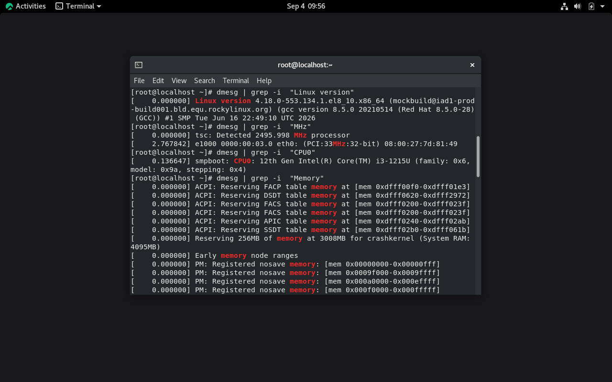

 
# Введение
 
## Цель и задачи работы
 
::: {.columns}
 
::: {.column width="50%"}
### Основная цель
Приобретение практических навыков установки операционной системы Linux на виртуальную машину и настройки базовых сервисов.
:::
 
::: {.column width="50%"}
### Ключевые задачи
- **VirtualBox:** Конфигурация параметров ВМ
- **Rocky Linux:** Установка и разметка ОС
- **Настройка:** Создание пользователей и сети
- **Анализ:** Проверка параметров через dmesg
:::
 
:::
 
## Техническое обеспечение
 
| Компонент | Значение / Требование |
|-----------|------------------------|
| **Гипервизор** | VirtualBox 6.1+ (Хост: Linux Gentoo) |
| **Целевая ОС** | Rocky Linux (x86_64) |
| **Оперативная память** | 2048 МБ+ (кратно 1024 МБ) |
| **Диск (VDI)** | 40 ГБ (динамический виртуальный) |
 
# Репозиторий и материалы
 
## Ссылки на релизы курса
 
Дополнительные материалы и версии лабораторных работ доступны в репозитории проекта:
 
- [Релиз 1](https://github.com/Shaqwal/Labs2026/releases/tag/v1.1.0)
- [Релиз 2](https://github.com/Shaqwal/Labs2026/releases/tag/v1.2.0)
- [Релиз 3](https://github.com/Shaqwal/Labs2026/releases/tag/v1.3.0)
- [Релиз 4](https://github.com/Shaqwal/Labs2026/releases/tag/v1.4.0)
- [Релиз 5](https://github.com/Shaqwal/Labs2026/releases/tag/v1.5.0)
- [Релиз 6](https://github.com/Shaqwal/Labs2026/releases/tag/v1.6.0)
- [Релиз 7](https://github.com/Shaqwal/Labs2026/releases/tag/v1.7.0)
- [Релиз 8](https://github.com/Shaqwal/Labs2026/releases/tag/v1.8.0)
 
# Требования и регламент
 
## Соглашения об именовании
 
::: {.callout-important}
### Важное правило
Имя виртуальной машины, имя хоста и имя пользователя внутри ВМ **ДОЛЖНЫ** совпадать с логином студента в дисплейном классе!
:::
 
Проверка своего логина в командной строке:
`id -un` (пример вывода: `username`, используется во всех дальнейших конфигурациях).
 
# Выполнение работы
 
## Этап 1. Подготовка рабочей среды
 
1. Переход во временный каталог:
   `cd /var/tmp`
 
2. Создание персональной директории:
   `mkdir /var/tmp/username`
 
3. Настройка пути по умолчанию в VirtualBox:
   `Файл` -> `Настройки` -> `Общие` -> `Папка для машин` = `/var/tmp/username`
 

 
## Этап 2. Параметры создания ВМ
 
::: {.columns}
 
::: {.column width="50%"}
### Система и Память
- **Имя машины:** username
- **Тип ОС:** Linux
- **Версия ОС:** Red Hat (64-bit)
- **RAM:** 2048 МБ
:::
 
::: {.column width="50%"}
### Диск и Носители
- **Тип диска:** VDI
- **Формат:** Динамический
- **Размер диска:** 40 ГБ
- **ISO-образ:** Rocky Linux 8.x
:::
 
:::
 

 
## Этап 3. Конфигурация установки ОС
 
- **Язык и раскладка:** English (US) по умолчанию + русская раскладка (переключение по Alt+Shift).
- **Программное обеспечение:**
  - *Base:* Server with GUI
  - *Add-on:* Development Tools
- **Сеть и службы:**
  - *Host Name:* user.localdomain
  - *KDUMP:* Отключить
 

 
## Коррекция имени пользователя и Hostname
 
Если при установке параметры отличались от регламента, выполнить в терминале под root:
 
1. `su -`
2. `adduser -G wheel username`
3. `passwd username`
4. `hostnamectl set-hostname username`
5. `hostnamectl` (проверка)
 

 
## Постустановочные действия
 
1. **Лицензионное соглашение:** При первом запуске принять условия EULA.
2. **Guest Additions:** Подключить образ диска дополнений гостевой ОС через меню *Устройства*.
3. **Перезагрузка:** Выполнить корректную перезагрузку системы после сборки модулей ядра.
 

 
# Самостоятельная работа
 
## Анализ системы через dmesg
 
Команды для анализа логов загрузки:
- `dmesg | less`
- `dmesg | grep -i "pattern"`
 
**Снимаемые параметры:**
- Версия ядра Linux
- Модель и частота процессора
- Объем доступной RAM
- Тип гипервизора
- Тип корневой ФС и порядок монтирования
 

 
# Отчётность
 
## Требования к отчёту
 
1. **Вводная часть:** Титульный лист и чёткая формулировка цели работы.
2. **Ход работы:** Описание выполненных шагов, используемые команды и скриншоты результатов.
3. **Выводы & Контрольные вопросы:** Итоговые выводы и ответы на 5 контрольных вопросов.
 
# Заключение
 
## Вопросы?
 
::: {.center}
### Спасибо за внимание!
:::
