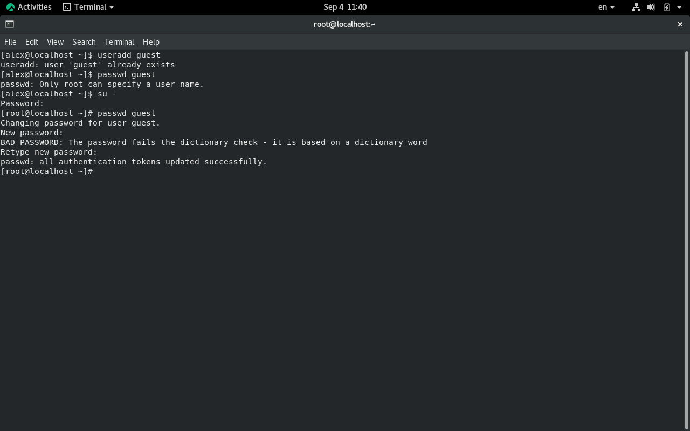
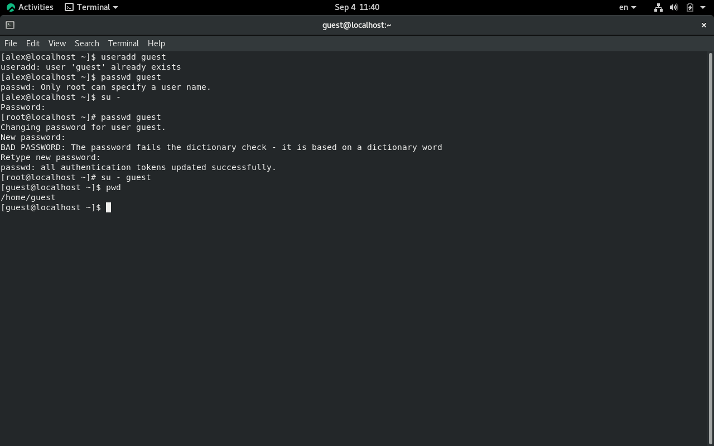
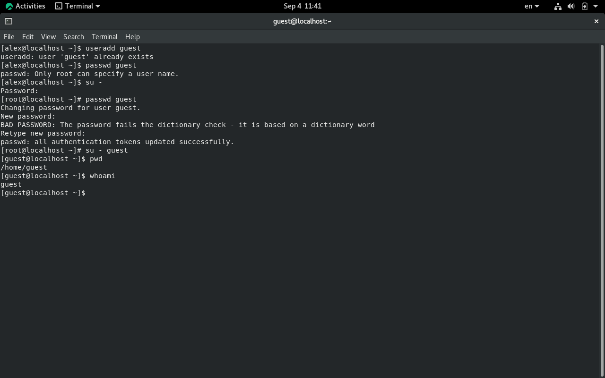
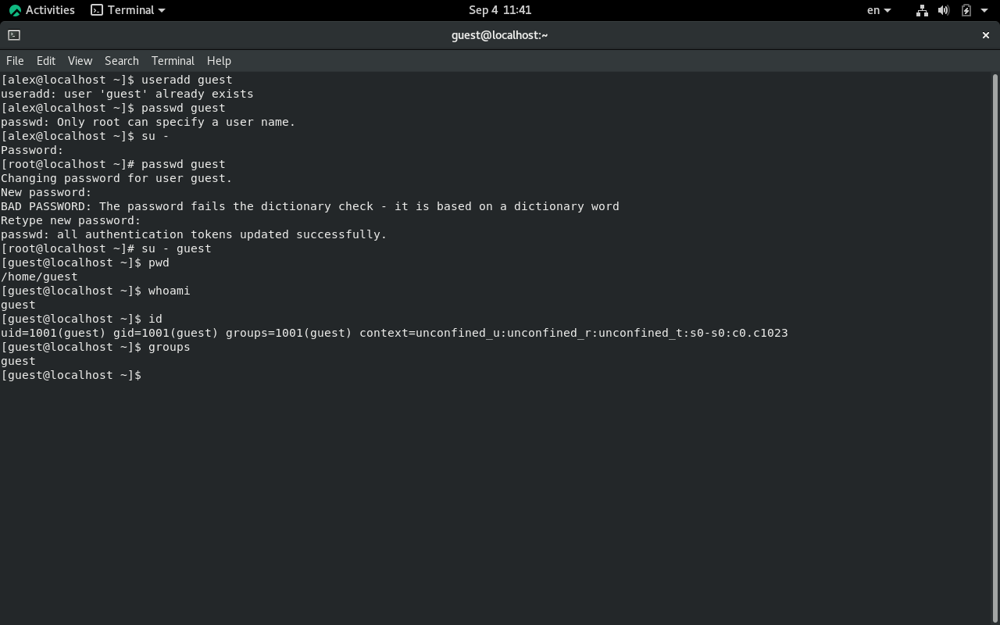

 
# Введение
 
## Цель и задачи работы
 
::: {.columns}
 
::: {.column width="50%"}
### Основная цель
Изучение механизма дискреционного разграничения доступа (DAC) в операционных системах Linux и исследование атрибутов файлов и каталогов.
:::
 
::: {.column width="50%"}
### Ключевые задачи
- **Учетные записи:** Создание пользователя `guest`, проверка UID и GID.
- **Права каталогов:** Исследование влияния бита выполнения `x` при `chmod 000`.
- **Матрица прав:** Проверка 64 комбинаций прав владельца.
- **Минимальные права:** Определение минимальных прав для типовых операций.
:::
 
:::
 
## Техническое обеспечение и среда
 
| Компонент | Значение / Параметр |
|-----------|---------------------|
| **ОС** | Rocky Linux (x86_64) в VirtualBox |
| **Тестовый пользователь** | `guest` (UID: 1001) |
| **Основные утилиты** | `chmod`, `ls`, `id`, `mkdir`, `touch` |
| **Объекты исследования** | Файлы и каталоги в домашнем каталоге |
 
# Репозиторий и материалы
 
## Ссылки на релизы курса
 
Дополнительные материалы и версии лабораторных работ доступны в репозитории проекта:
 
- [Релиз 1](https://github.com/Shaqwal/Labs2026/releases/tag/v1.1.0)
- [Релиз 2](https://github.com/Shaqwal/Labs2026/releases/tag/v1.2.0)
- [Релиз 3](https://github.com/Shaqwal/Labs2026/releases/tag/v1.3.0)
- [Релиз 4](https://github.com/Shaqwal/Labs2026/releases/tag/v1.4.0)
- [Релиз 5](https://github.com/Shaqwal/Labs2026/releases/tag/v1.5.0)
- [Релиз 6](https://github.com/Shaqwal/Labs2026/releases/tag/v1.6.0)
- [Релиз 7](https://github.com/Shaqwal/Labs2026/releases/tag/v1.7.0)
- [Релиз 8](https://github.com/Shaqwal/Labs2026/releases/tag/v1.8.0)
 
# Требования и регламент
 
## Соглашения об именовании и правах
 
::: {.callout-important}
### Важное правило DAC
Доступ к файлу в Linux определяется не только правами самого файла, но и правами доступа к его родительскому каталогу (особенно битом `x` для прохода).
:::
 
Проверка текущего пользователя и идентификаторов:
`id` (вывод UID, GID и групп пользователя `guest`).
 
# Выполнение работы
 
## Этап 1. Подготовка и проверка учетной записи
 
1. Вход в систему под учетной записью `guest`:
   `whoami`
2. Проверка идентификаторов:
   `id`
3. Проверка прав домашнего каталога `/home/guest`:
   `ls -ld /home/guest`
 

 
## Этап 2. Исследование режима каталога (`000`)
 
::: {.columns}
 
::: {.column width="50%"}
### Действия
- Создан тестовый каталог `dir1` и файл внутри него.
- Сброшены все права каталога: `chmod 000 dir1`.
- Выполнена попытка доступа к файлу.
:::
 
::: {.column width="50%"}
### Выводы
- Без бита `x` на каталог невозможно ни просмотреть его содержимое (`r`), ни обратиться к файлу внутри него, даже при полных правах на сам файл.
:::
 
:::
 

 
## Этап 3. Анализ 64 комбинаций прав
 
- Проверено 8 вариантов масок владельца каталога и 8 вариантов масок файла ($8 \times 8 = 64$ комбинации).
- Установлено, что для чтения (`r`) или записи (`w`) файла требуется обязательное наличие права прохода (`x`) у родительского каталога.
- Результаты зафиксированы в таблице `lab02-table21.tsv`.
 

 
## Этап 4. Минимальные права для операций
 
| Операция | Требуемые права на каталог | Требуемые права на файл |
|:--|:--:|:--:|
| Создать / удалить файл | `wx` | — |
| Читать файл | `x` | `r` |
| Записать в файл | `x` | `w` |
| Создать подкаталог | `wx` | — |
| Удалить пустой подкаталог | `wx` (родителя) | — |
 

 
# Заключение
 
## Итоги и выводы
 
Цель лабораторной работы достигнута: изучены атрибуты объектов файловой системы и правила дискреционного разграничения доступа в Linux. Гипотеза подтверждена — доступ к файлу зависит как от прав самого файла, так и от прав доступа к родительскому каталогу.
 
## Вопросы?
 
::: {.center}
### Спасибо за внимание!
:::
