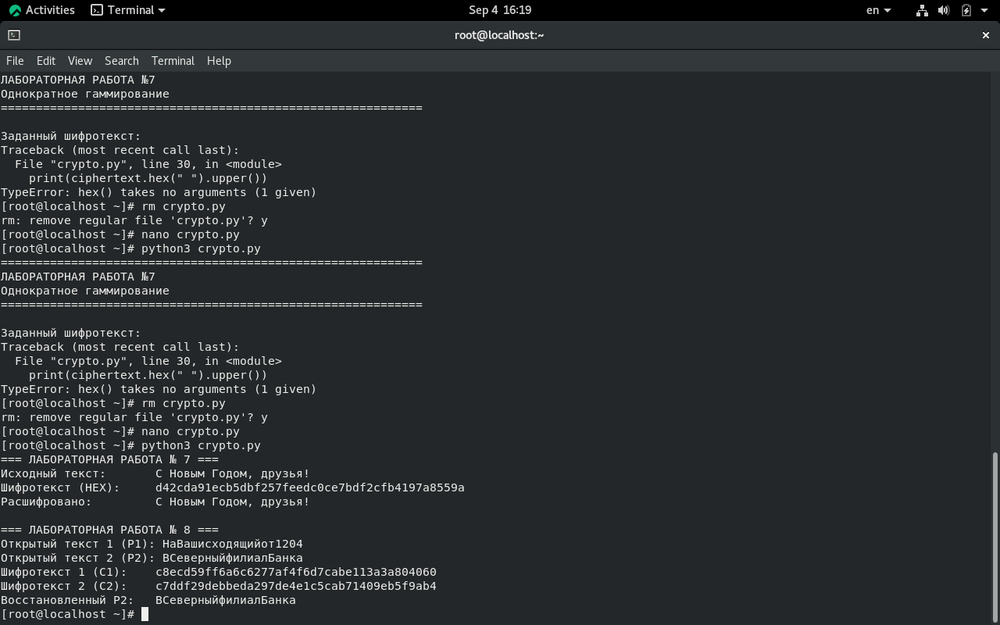

 
# Введение
 
## Цель и задачи работы
 
::: {.columns}
 
::: {.column width="50%"}
### Основная цель
Освоить применение режима однократного гаммирования на примере кодирования различных исходных текстов одним ключом.
:::
 
::: {.column width="50%"}
### Ключевые задачи
- Реализовать шифрование двух текстов ($P_1$ и $P_2$) одним ключом.
- Продемонстрировать уязвимость повторного использования гаммы ($C_1 \oplus C_2 = P_1 \oplus P_2$).
- Восстановить открытый текст без знания ключа по известному шаблону.
:::
 
:::
 
## Материалы и методы
 
- **ОС и ПО:** Rocky Linux 9.8, Python 3, VirtualBox.
- **Студент:** Назиров Алексей Анваржанович (ID: 1032240002).
- **Методика:** побайтовый XOR, использование кодировки `cp1251` для однобайтового соответствия символов.
- **Объект:** две телеграммы длиной по 20 байт и общий ключ.
 
# Теория и анализ
 
## Исключение повторённой гаммы
 
Если два открытых текста зашифрованы одним ключом:
$$C_1 = P_1 \oplus K$$
$$C_2 = P_2 \oplus K$$
 
При сложении шифротекстов по модулю 2 (XOR) ключ взаимно уничтожается:
$$C_1 \oplus C_2 = P_1 \oplus P_2$$
 
Зная фрагмент одного из текстов (шаблон), можно поэлементно восстановить второй текст.
 
# Выполнение работы
 
## Программа и исходные данные
 
- Разработан скрипт на Python с поддержкой аргументов командной строки.
- Заданы две телеграммы и общий ключ длиной 20 байт.
- Ошибочные байты в кодировке обработаны с использованием `cp1251`.
 

 
## Шифрование телеграмм
 
- Получен шифротекст $C_1$ для первой телеграммы ($P_1$).
- Получен шифротекст $C_2$ для второй телеграммы ($P_2$) с тем же ключом.
- Выполнено обратное расшифрование для проверки корректности.
 

 
## Анализ уязвимости и восстановление текста
 
- Вычислен XOR двух шифротекстов без использования ключа ($C_1 \oplus C_2$).
- С помощью известного шаблона первой телеграммы восстановлен текст второй телеграммы.
- Проведено сопоставление результатов с исходными данными.
 

 
# Заключение
 
## Выводы
 
- На практике изучена критическая уязвимость повторного использования однократного ключа (гаммы).
- Доказано, что повторное применение ключа компрометирует конфиденциальность сообщений, позволяя злоумышленнику восстановить открытые тексты.
- Цель лабораторной работы полностью достигнута.
 
## Вопросы?
 
::: {.center}
### Спасибо за внимание!
:::

